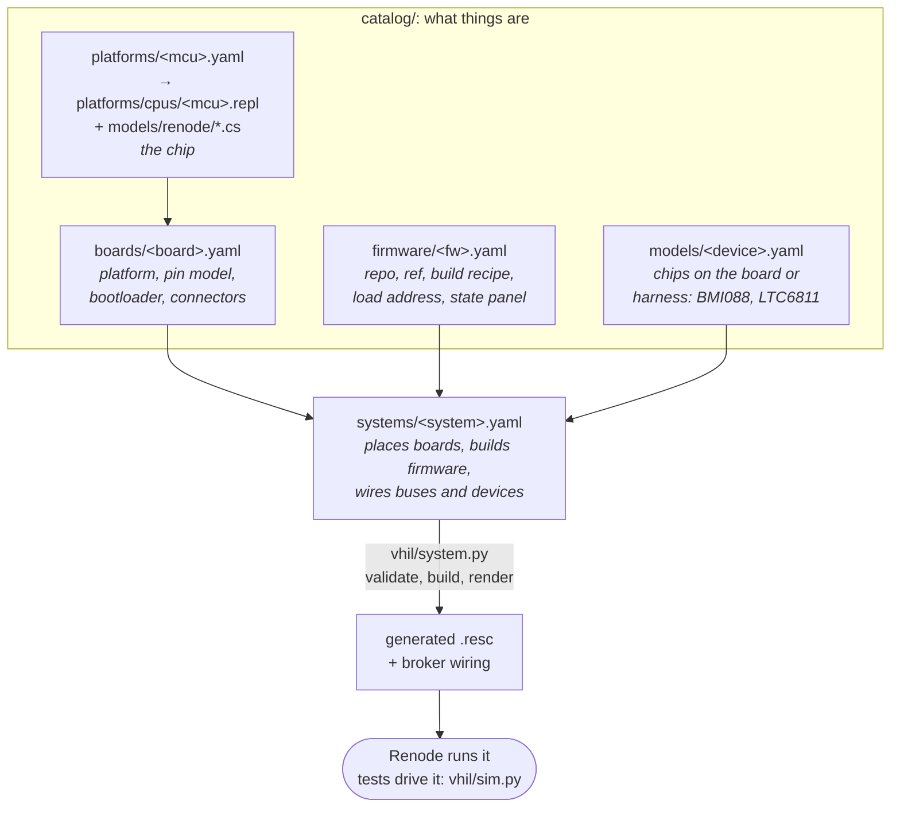

# Adding a board

How to bring a new PCB into the vHIL: which files say what, the order to do
it in, and when each step is done. Read [`CONTRIBUTING.md`](../../CONTRIBUTING.md)
first for setup and the PR flow. The hard rules are the invariants in
[`CLAUDE.md`](../../CLAUDE.md#hard-invariants): they are cited below by
number.

There are two cases:

- **A new role on the MainLite** (same STM32H733 board on a new backplane,
  new firmware). The uDV was the last one. This is mostly catalogue and
  system data: [jump to it](#case-a-a-new-role-on-the-mainlite).
- **A new board with its own MCU**, e.g. the SensorHub (STM32L496). This
  needs a platform, models and data. It is most of this page. The SensorHub's
  own brief and plan: [`docs/boards/sensorhub.md`](../boards/sensorhub.md).

## How the pieces fit



- The **catalogue** (`catalog/`) says what things *are*. A system says how
  they are *put together*. Never put a car-specific name in the catalogue.
- Scripts are **generated**. Never hand-edit a `.resc`.
- `python -m vhil.system validate systems/<s>.yaml` checks a system against
  the schema (`schemas/vhil.schema.json`) and the catalogue. `unit` CI runs
  it on every system.

## Case B: a new board with its own MCU

Do the steps in order: each one gives you something you can run.

### 1. Platform: the chip

Files:
- `platforms/cpus/<mcu>.repl`: the memory map. Usually you start from a
  Renode platform of the same family and override what differs.
- `catalog/platforms/<mcu>.yaml`: points to the `.repl`, lists the extra
  `models/renode/*.cs` sources to compile (in load order), and any
  `renode.reset` commands.

Rules:
- **Every address and IRQ comes from ST's device header**
  (`stm32<part>xx.h` in the CubeMX/STM32Cube package) and the reference
  manual (invariant 10). Cite them in a comment on each line. Never guess or
  copy one from a sibling chip without checking.
- Set the board's real **HSE** (`rcc.hseFrequency`). A wrong HSE scales every
  FreeRTOS period (see invariant 2 for the MainLite's).
- Model the app's **HAL timebase** (SysTick or the TIM the `.ioc` picks).
  Without it every HAL timeout spins forever (invariant 3 for the MainLite).
- **Unmodelled registers fail the run** (invariant 7). Reads return 0 and
  writes are dropped, and the peripheral guard fails the session unless
  [`configs/peripherals.yaml`](../../configs/peripherals.yaml) lists the
  access with a reason it can't change what a test sees. Prefer modelling.
- Invariant 6 (BASEPRI on reset) is a Renode bug that hits every Cortex-M.
  Copy the `renode.reset` commands of `catalog/platforms/stm32h733.yaml`.

Done when: an ELF of the firmware boots in Renode to `main()` and its
SysTick/HAL tick runs (`scripts/vhil-docker.sh shell`, then
`renode --console -P -1`, `include @platforms/cpus/<mcu>.repl`, load the ELF,
`start`).

### 2. CAN on the bus model

Every CAN bus is [`models/renode/VhilCanBus.cs`](../../models/renode/VhilCanBus.cs)
([`docs/can-bus.md`](../can-bus.md)): arbitration, bit time, ACK and error
counters in virtual time. A controller joins it by implementing
**`IVhilCanController`** (defined in
[`models/renode/Stm32H7Fdcan.cs`](../../models/renode/Stm32H7Fdcan.cs), the
reference implementation): bit rate from the controller's timing register,
auto-retransmission, whether it acknowledges and receives, the TEC, and
offering its pending Tx requests to the bus.

- Until your controller implements it, a bus can use Renode's plain CAN hub
  with `arbitration: false` on the bus entry. Any Renode `ICAN` peripheral
  works there, but the hub has no timing, ACK or load. Use it only to get
  frames moving.
- Port the relevant tests of `tests/sim/test_can_bus.py` and
  `tests/sim/test_fdcan_faults.py` to your controller: ACK errors,
  arbitration, bit time.

Done when: the controller is on the bus model, and a test sees its frames at
the right bit time with ACK from another node.

### 3. Devices: the chips around the MCU

Each device is a `.cs` model plus `catalog/models/<id>.yaml` (interface,
targets, test API in the description). **Reuse before writing.** Check
`catalog/models/` and Renode's own models first. A model follows the
**datasheet**, not what one firmware happens to use, and exposes a small
monitor API for tests (`SetAcceleration`, `Respond false`, …). See
[`models/renode/Bmi088.cs`](../../models/renode/Bmi088.cs) for the style.

Done when: a test sets a value through the model's API and the firmware
reports it (on CAN, in a variable).

### 4. Board: `catalog/boards/<board>.yaml`

The board entry names:
- `platform`;
- optionally `pin_model` and `bootloader`;
- its connectors (`can`, `spi`, `uart`, `i2c`, `gpio`, `analog_in`,
  `sdmmc`) and its `onboard` peripherals.

Copy the structure of [`catalog/boards/mainlite.yaml`](../../catalog/boards/mainlite.yaml).

- **Bootloader:** boot exactly as the car does (invariant 5 is the
  MainLite's version of this rule). If the board has the team's CAN
  bootloader, name it. If it runs straight from reset (ST's ROM DFU
  bootloader doesn't count, it only runs with BOOT0 high), leave
  `bootloader` out.
- **Roles** are a MainLite concept (one board, many backplanes). A
  single-purpose board needs none: the system names its `firmware:` directly.
- **Pin model:** optional at first. It's needed once `validate` should refuse
  pins the board doesn't route. Today `vhil/pin_model.py` reads only the
  MainLite's schema (`isc-fs/mainlite-pins` v1), so a second board's pin
  model means generalising that schema. Open an issue when you get there.

### 5. Firmware: `catalog/firmware/<fw>.yaml`

Firmware entries hold `repo`, `ref`, the `build` recipe (`toolchain`,
`configure`, `build`, `elf`, `recipe_source`), `load.vector_table`, `cpu.mips`
and `state_view`. Copy [`catalog/firmware/udv.yaml`](../../catalog/firmware/udv.yaml).

- **Invariant 1:** the vHIL runs the image the car runs. Build it with the
  firmware repo's own production recipe (IFS_HIL's
  `configs/firmware/<dut>.yaml` when one exists) and say where it came from
  in `recipe_source`. Never add an emulator-only build flag or patch the
  firmware. If the firmware does something the model can't follow, fix the
  model.
- `cpu.mips`: see [`docs/cpu-timing.md`](../cpu-timing.md). Start from the
  chip's datasheet DMIPS/MHz × SYSCLK and refine.
- `state_view`: what the editor's state panel shows ([`docs/state-view.md`](../state-view.md)).

### 6. System: `systems/<board>.yaml`

Place the board, give it buses and devices, and comment every endpoint with
where it comes from (schematic sheet, connector pin, firmware file). Copy
[`systems/udv.yaml`](../../systems/udv.yaml). Then:

```sh
python -m vhil.system validate systems/<board>.yaml
scripts/vhil-docker.sh fw <board>        # builds the firmware into the vhil-data volume
```

### 7. Tests: `tests/sim/test_<board>_*.py`

- Start with a boot test (`test_udv_boot.py` is the pattern): the app runs,
  its heartbeat or first CAN frame comes out on time.
- Every test file sets `pytestmark` with its board, system and subsystem
  markers. Markers are strict: add new ones to `pytest.ini`.
- Add the firmware id to `BOARDS` in `tests/conftest.py`. That gives you
  `--<board>-elf` and `$VHIL_<BOARD>_ELF`.
- Tests assert what the **car** does, from schematics, datasheets and the
  firmware's intent (invariant 9), never what the physical bench happens to
  do.

### 8. CI wiring

- `ci/impact.yaml`: a rule mapping your board's paths (platform, models,
  firmware, systems) to its tests. New catalogue paths already fall under
  `everything`, so you are safe by default, just slow. Details in
  [`docs/ci.md`](../ci.md).
- `scripts/fingerprint.py`: add the system to `SYSTEMS`, its watched pins
  to `WATCHED` and its ELF variable to `ENV`. Then commit the guard's
  artifact as `ci/fingerprints.json` (the guard job of a `full-ci` run
  uploads it).
- Workflows: `.github/workflows/sim.yml` builds firmware per board. Add
  yours to its loops.
- Label the PR **`full-ci`**: it touches emulation.

### Places that still list the boards by hand

The pipeline is mostly data-driven, but these lists name boards, firmware or
systems literally. Update the ones your board needs:

| File | What |
|---|---|
| `tests/conftest.py` `BOARDS` | firmware ids that get `--<id>-elf` |
| `pytest.ini` | board and system markers (strict) |
| `scripts/fingerprint.py` `SYSTEMS`, `WATCHED`, `ENV` | guard fingerprints |
| `scripts/vhil-docker.sh` `fw`, `sim` | default builds and the ELF env vars |
| `scripts/speed.py` | default systems and ELF env map |
| `scripts/ci-select.py` `SMOKE`, `IFS_HIL` | which boards get smoke / IFS_HIL jobs |
| `.github/workflows/sim.yml`, `smoke.yml`, `scenarios.yml`, `select.yml` | per-board build loops and outputs |
| `vhil/system.py` `ROLES`, `schemas/vhil.schema.json` `$defs/role` | MainLite roles only |
| editor `nodes.css`, `vhil/server/static/tokens.css` | role colours (roles only) |

## Case A: a new role on the MainLite

Same order, but steps 1–4 shrink to data:

1. `catalog/boards/mainlite.yaml`: a new `roles:` entry (node id, flash bus,
   firmware, backplane page, pins).
2. `vhil/system.py` `ROLES` and `schemas/vhil.schema.json` `$defs/role`.
3. `docs/backplanes/<role>.md`: the backplane pin map, cited row by row.
4. Steps 5–8 above. The editor needs a role colour.

The uDV's history shows the whole path:

```sh
git log --oneline --reverse -- catalog/firmware/udv.yaml systems/udv.yaml \
    tests/sim/test_udv_boot.py docs/backplanes/udv.md
```

The key commits are:
- `556c967`: firmware entry and role;
- `e0a524f`: systems and native tests;
- `9e9b98d`: test markers;
- `6b1e5c0`: fingerprints.

`git show --stat <sha>` lists what each one touched.

## Definition of done

- `scripts/vhil-docker.sh unit` passes, and `validate` passes on the new system.
- A boot test and at least one behaviour test pass in `sim`. They are
  deterministic: two runs give the same result.
- `configs/peripherals.yaml` has no unexplained entries. Gaps are
  `KNOWN GAP #<issue>`.
- The board's `docs/` page is up to date: what is modelled, what isn't, and
  where each fact comes from.
- A `full-ci` run is green, and `ci/fingerprints.json` is updated.
